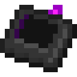

{ .item-icon }

# Dismantler

The Dismantler removes a formed multiblock in one pass and returns everything it was made of.

## What it does

- Shift + right-click a formed multiblock controller to open a preview that lists every block, cover and fluid the structure will give back.
- Confirm to dismantle: the whole structure is removed and its contents are collected.

## ME network link

The Dismantler connects to your ME network through a Wireless Access Point, the same way as the Multi-Structure Manager and the Schematic Interface.

- Link it by placing the Dismantler into a Wireless Access Point, its tooltip shows the status.
- While linked and in range, overflow blocks and drained fluids are sent to the network instead of the ground (if the network has space obviously).